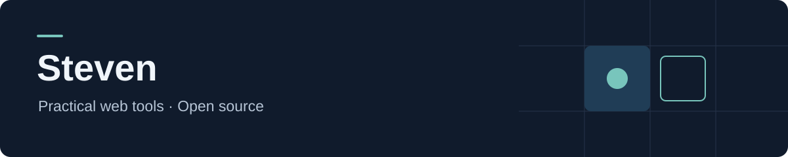

I build small web applications around real workflows, and share reusable parts as open source.

我在这里记录项目的开发与维护，也把实际使用中积累的功能整理成可以自行部署的工具。

### Current project

**[Open Workstations](https://github.com/stevenlee-dev/open-workstations)** — a self-hosted application system for laboratories and shared workspaces.

- Configure rooms, seat layouts, and flexible, rotating, or fixed usage policies.
- Submit applications and supporting files; review requests with date conflict checks.
- Run locally or with Docker, with configuration and deployment guides included.

**Project stack:** Vue · JavaScript · Node.js · Express · SQLite

### Get involved

Questions, bug reports, and practical improvements are welcome through [Issues](https://github.com/stevenlee-dev/open-workstations/issues) and [Pull Requests](https://github.com/stevenlee-dev/open-workstations/pulls).

欢迎反馈使用中遇到的问题。提交问题时，请附上复现步骤和运行环境；参与开发可以先看[贡献指南](https://github.com/stevenlee-dev/open-workstations/blob/main/CONTRIBUTING.md)。
